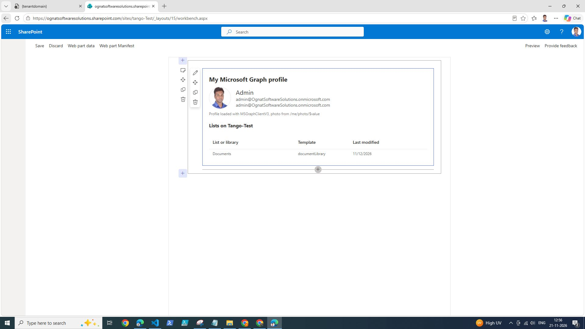

# spg-graph-api

## Summary

An SPFx web part that calls Microsoft Graph from SharePoint Online. It shows the signed-in user's profile (name, job title, email, office location and photo) and lists the visible lists and libraries on the current site, sorted by last modified date.

The same profile call is implemented twice, once with the `MSGraphClientV3` client and once with PnPjs `graphfi()`, so the two approaches can be compared. Switch between them with the `profileSource` property.

Built with React function components, Fluent UI (`Persona`, `DetailsList`, `MessageBar`, `Spinner`), TypeScript, Microsoft Graph and PnPjs.



## Used SharePoint Framework Version


## Applies to

- [SharePoint Framework](https://aka.ms/spfx)
- [Microsoft 365 tenant](https://docs.microsoft.com/en-us/sharepoint/dev/spfx/set-up-your-developer-tenant)

> Get your own free development tenant by subscribing to [Microsoft 365 developer program](http://aka.ms/o365devprogram)

## Prerequisites

- Node.js version supported by SPFx 1.20 (Node 18.x)
- A Microsoft 365 tenant with an App Catalog
- Permission to approve API access requests (SharePoint Administrator or Global Administrator)
- Graph permissions requested by the package, which must be approved in **SharePoint admin center > Advanced > API access**:
  - `User.Read`
  - `Sites.Read.All`

## Solution

| Solution      | Author(s)                    |
| ------------- | ---------------------------- |
| spg-graph-api | Praveen (Ognat Software Solutions) |

## Version history

| Version | Date              | Comments        |
| ------- | ----------------- | --------------- |
| 1.0.0.0 | November 21, 2026 | Initial release |

## Disclaimer

**THIS CODE IS PROVIDED _AS IS_ WITHOUT WARRANTY OF ANY KIND, EITHER EXPRESS OR IMPLIED, INCLUDING ANY IMPLIED WARRANTIES OF FITNESS FOR A PARTICULAR PURPOSE, MERCHANTABILITY, OR NON-INFRINGEMENT.**

---

## Minimal Path to Awesome

- Clone this repository
- Ensure that you are at the solution folder
- In the command-line run:
  - **npm install**
  - **gulp trust-dev-cert** (first time only)
  - **gulp serve**
- Graph calls do not work in the local workbench. Open the hosted workbench of your site instead:
  `https://<your-tenant>.sharepoint.com/sites/<your-site>/_layouts/15/workbench.aspx`
- To deploy:
  - **gulp bundle --ship**
  - **gulp package-solution --ship**
  - Upload `sharepoint/solution/spg-graph-api.sppkg` to the App Catalog and select **Deploy**
  - Approve `User.Read` and `Sites.Read.All` in **SharePoint admin center > Advanced > API access**

> If you have deployed this solution before, bump the version in `config/package-solution.json` so the new permission requests appear.

## Features

This web part illustrates the following concepts:

- Requesting Graph permissions with `webApiPermissionRequests` in `package-solution.json`
- Getting a Graph client with `msGraphClientFactory.getClient('3')`
- Calling `/me` and `/me/photo/$value`, with a graceful fallback when the user has no photo (404)
- Reading a site and its lists with `/sites/{site-id}` and `/sites/{site-id}/lists`, building the site ID from the page context
- Using PnPjs `graphfi()` with `SPFx(this.context)` as an alternative to the Graph client
- Separating Graph calls into a service class (`GraphService`) with typed models
- Handling errors separately for profile and lists, so a missing `Sites.Read.All` approval does not hide the profile
- Releasing object URLs and cancelling stale async work in `useEffect`

Project structure:

```
src/webparts/graphProfile
  components/   React component and props
  Models/       IGraphData.ts (interfaces and types)
  Services/     GraphService.ts (Graph and PnPjs calls)
  loc/          localized strings
```

## References

- [Getting started with SharePoint Framework](https://docs.microsoft.com/en-us/sharepoint/dev/spfx/set-up-your-developer-tenant)
- [Building for Microsoft teams](https://docs.microsoft.com/en-us/sharepoint/dev/spfx/build-for-teams-overview)
- [Use Microsoft Graph in your solution](https://docs.microsoft.com/en-us/sharepoint/dev/spfx/web-parts/get-started/using-microsoft-graph-apis)
- [Publish SharePoint Framework applications to the Marketplace](https://docs.microsoft.com/en-us/sharepoint/dev/spfx/publish-to-marketplace-overview)
- [Microsoft 365 Patterns and Practices](https://aka.ms/m365pnp) - Guidance, tooling, samples and open-source controls for your Microsoft 365 development
